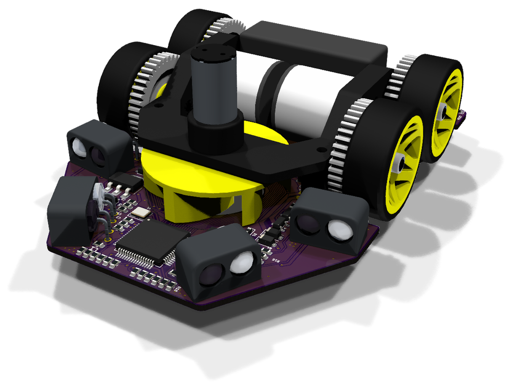

  

<h1 align="center">Ratatron II</h1>

  Micromouse robot with four-wheel drive and a suction fan.

  
  
  
  
  
  

> **Work in progress.** The board is being routed and the firmware is waiting for it. The picture is the KiCad 3D
> view, not a photo (yet).

## What's inside

| | |
|---|---|
| **MCU** | STM32F446RET6, Cortex-M4F at 180 MHz |
| **Wall sensors** | 4 IR pairs: SFH4550 emitters and ST-1KL3A phototransistors |
| **IMU** | LSM6DSRX (gyro and accelerometer) over SPI |
| **Drive** | 4 wheels, 2 motors, 2 DRV8874 H-bridges at 20 kHz with current sensing |
| **Encoders** | 2 AS5147P, magnetic, on little boards that snap off the main one |
| **Suction** | a fan driven by a coreless motor, over a hole in the middle of the board |
| **Battery** | 2S LiPo |
| **Interface** | 6 blue LEDs, 2 buttons and a power switch |
| **Connectors** | SWD through a magnetic connector, serial on a header |

## Where things are

- [firmware](firmware/): C on libopencm3, built with PlatformIO (`cd firmware && pio run`, flashed with an ST-Link)
- [hardware](hardware/): KiCad 9 schematic, PCB and custom library
- [mechanics](mechanics/): FreeCAD model (wheels, motor and fan supports)

## Family

- [Ratatron](https://github.com/JavierIH/ratatron), the first one: an STM32F103 that already finds its way out of
  mazes
- [Ratasim](https://github.com/JavierIH/ratasim), the simulator

## Licence

- Firmware: GPLv3 ([LICENSE](LICENSE))
- Electronics: CC BY-SA 4.0 ([hardware/LICENSE](hardware/LICENSE))
- Mechanics: CC BY-SA 4.0 ([mechanics/LICENSE](mechanics/LICENSE))
